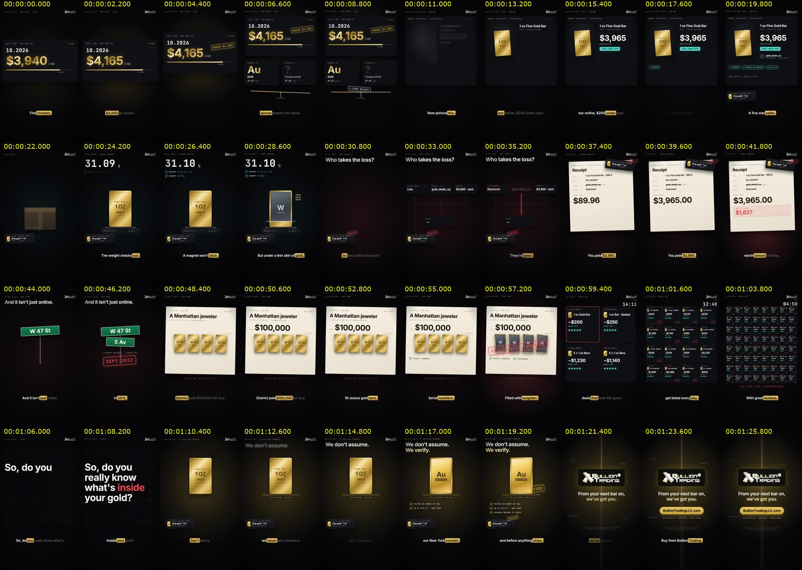
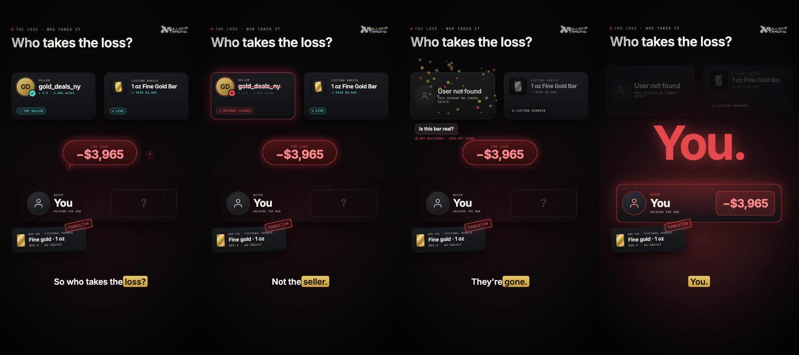
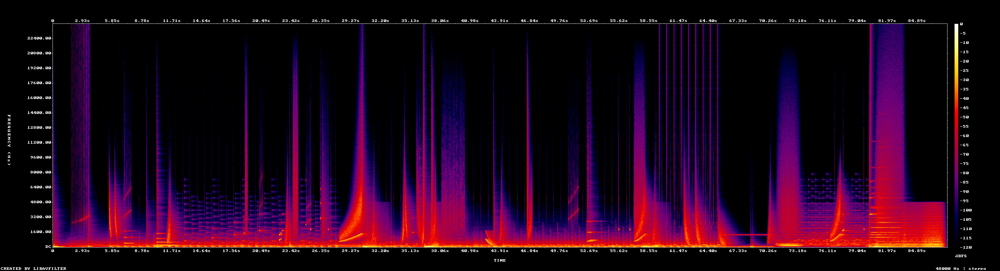

# 03 · Graphics system

How Bullion Trading films look and move, and the code that draws them. Every visual is authored in React
(`src/`); product photography is the only raster artwork. Three visual systems exist — pick the one that fits
the message, and keep a film inside one system.

## Canvas and safe zones (vertical, 1080 × 1920, 60 fps)

| Zone (y, px) | Use |
| --- | --- |
| 0 – 120 | platform UI (status bar, handles) — nothing important |
| 106 – 190 | masthead logo (premium) **or** kicker line at y 150 + house mark top-right (story) |
| 196 – 290 | headline (64–70 px, one or two lines) |
| 220 – 1380 | the stage: products, documents, cards, diagrams |
| 1236 – 1370 | story films: the carried object's resting place (bottom-left) |
| 1468 / 1490 | captions (premium / story) — one short phrase |
| 1600 – 1920 | platform UI (description, buttons) — nothing important |

Side margins 64 px. The right edge (≈ 960 – 1080) is crossed by platform buttons on Reels/TikTok — keep text clear
of it below y 1200.

**Minimum sizes on a phone:** captions 46 px · headlines 64 px · state labels / chips 18–19 px ·
small labels 15–16 px · decorative mono kickers 19 px (they may be small; they must never carry meaning alone).

## System 1 — Premium (black, gold, light)

`src/marketing-premium/kit/` — used by the premium, premium-2 and premium-3 films.

- **Palette** (`theme.ts`): black `#050506`, ink `#0b0b0e`, ivory `#f4eedf`, champagne `#d9c79b`, gold `#d4af37`
  (light `#f6e3a1`, deep `#8a6a1f`), silver `#dfe4ea`, rose `#e9b9a4`. Metal gradients `GOLD_GRADIENT`,
  `SILVER_GRADIENT`, `ROSE_GRADIENT`. Per-film key light: `TINTS.gold | rose | regal | city`.
- **Type**: Cormorant Garamond 500/600 (+ italic) for display, Inter 400–600 for UI and captions.
- **Light as transition**: `SceneShell` — every scene arrives out of a bloom of light and leaves by pushing into
  it, with a slow dolly-in; `CutFlare` blooms a warm wash and an anamorphic streak across each cut.
- **Product as hero**: `Product` / `Coin` — cut-out photos lit like studio stills (contact shadow, optional floor
  reflection, a specular band sweeping across the metal, masked to the product's silhouette).
- **Metallic type**: `Metal` (brushed gradient fill with a travelling specular band); `Rise` (blur-and-rise
  entrance, the default for all type); `MaskLine`; `Eyebrow`; `serif()`, `italic()`, `caps()` style helpers.
- **Set pieces** (`Pieces.tsx`): `Skyline`, `Phone`, `Pin` (map pin), `Litany` (timed list).
- **Frame**: `Masthead` (logo letterhead "New York · Since 2008", hidden on the end card), `Atmosphere` (studio
  light), `Finish` (film grain + lens vignette over everything), `EndCard` (shared close with hero products).
- **Captions**: the spoken word is filled with the gold gradient; upcoming words dim; ≤ 30 characters per page.
- **FAQ series** (`marketing-premium-3/faq-kit.tsx`): every film opens on its question (`QuestionScene`) and
  labels its answer (`AnswerLabel`).
- **Film shell**: `PremiumVideo` places scenes on the schedule, adds masthead, captions, flares, grain, voice and score.

## System 2 — Story HUD (dark evidence room)

`src/marketing-story/kit.tsx` and `WhatsInside-who.tsx` — used by *What's inside?*. For trust, risk and
"what really happens" stories.

**Colour has a job — keep it:**

| Colour | Token | Means |
| --- | --- | --- |
| Teal `#4fd1c5` | `K.teal` | looks safe / passes (listing badges, scale ✓, magnet ✓) |
| Red `#e5484d` | `K.red` | danger, loss, stamps, the answer "You." |
| Steel `#8e98a4` | `K.steel` | tungsten, anything cold or fake |
| Cream `#efe8d8` + ink `#1d1b17` | `K.paper`, `K.ink` | documents: receipts, case files |
| Gold `#d4af37` → `#f6e3a1` | `K.gold` | **Bullion Trading only**: caption pill, the replay, verified, end card |

Near-black ground `#07070a` with a drifting dot grid. Type: Inter 600 (headlines, captions, numbers) and
JetBrains Mono (kickers, labels, readouts, sources — uppercase, tracked). Units stay lowercase
(`g`, `g/cm³`, `oz`): set `textTransform: 'none'` on them.

**Components** (all take `frame` and word-cued times):

| Component | What it is |
| --- | --- |
| `Backdrop`, `Glow` | dot-grid floor; coloured key light that marks the beat (gold, red, steel) |
| `StoryShell` | scene push-in from blur / recede into blur |
| `Kicker` | `• SECTION · CONTEXT` mono line that types itself on |
| `Headline` | lines that rise in on their own words; second line carries the turn in colour |
| `Stamp` | rubber stamp that lands hard and stays crooked (IN FORCE, TUNGSTEN CORE, VERIFIED, LOSS …) |
| `KeyCap` | a key or app button pressed on its word ("Buy now") |
| `GoldBar` | generic, unbranded minted bar; `cut` sweeps a section scan showing a thin gold skin over **tungsten** or **solid gold** |
| `BarGlyph`, `BarTag` | small bar icon; the assay-style tag that travels through the film (`stamp`, `clip` options) |
| `Check` | ✓ row: label + value, colour by meaning; `ink` for use on paper |
| `Paper`, `SourceLine` | cream document; tiny mono source credit under evidence |
| `StoryCaptions` | one phrase; the spoken word on a gold pill, upcoming words dim |
| `Watermark` | house logo top-right |
| `count`, `money`, `jolt` | eased counters, `$` formatting, decaying camera shake on an impact |
| *Scene 4 kit* | `Avatar`, `Chip`, line `Icon`s (user, check, x, alert, eye-off), seller/listing/you profile cards, `LossChip` (with orbiting "?"), chat `Message` with delivery status, `Dust` (disintegration particles) |

## System 3 — Market brief HUD (legacy)

`src/theme.ts`, `src/components/`, `src/scenes/` (MetalsBrief, 16:9) and `src/bullion/` (BullionBrief, vertical):
neon data HUD — cyan `#00E5FF`, gold `#FFC83D`/`#FFD700`, red `#FF2D55`, green `#2BFF88` on near-black; Inter
Tight / Space Grotesk with JetBrains Mono; rolling numbers, kinetic words, terminal chrome, node fields. Use
for market updates, not for brand films.

## Motion rules

1. **Time everything to words.** A reveal lands on the word it answers: `cue('tungsten')`, `cue('You')`. Never
   place meaningful events by seconds; a re-read script moves them with the voice.
2. **Something moves from frame 1.** No empty first second; no dead air longer than ~0.5 s in any scene.
3. **One idea per beat.** If a frame needs explaining, split it across words.
4. **Entrances 14–20 frames ease-out** (`EASE.out`); exits 10–12 frames ease-in; stamps land in 9 frames.
5. **Count, don't state**: prices, grams, losses and totals count up/down on their word.
6. **Carry one object** through a story (the bar tag) as a layer *above* the scene shells, so it survives cuts.
7. **Pay off with a replay**: show the fix as the same scene going right (same bar, same scan, gold result).
8. **Make the answer replace the question's clutter**: clear busy elements a few frames before the big word.
9. **Impacts get a jolt** (`jolt()`) and a coloured bloom — only on the two or three biggest reveals.
10. **Honesty on screen**: "fictional example" on invented listings/receipts; "illustration" on drawn evidence;
    sources under real facts; no real refiner's product in a counterfeit context.

## Sound rules (scores are synthesized in `scripts/*-score.py` / `*-sound.py`)

- Music ducks ~7–8 dB under the voice, effects ~3 dB; scores sit around −21 to −24 LUFS before the final
  −14 LUFS master.
- Every visual event that matters has a sound: pops for cards, ticks for counters, a stamp thump, a scanner
  sweep, a printer for receipts, air on every cut.
- Keep a hierarchy: the biggest hit belongs to the biggest reveal (in *What's inside?*: "You." > tungsten >
  everything else). Check it in the score's peak list (04-review).
- Silence is a tool: the question before the relief is the quietest moment; relief arrives with warmer harmony.

