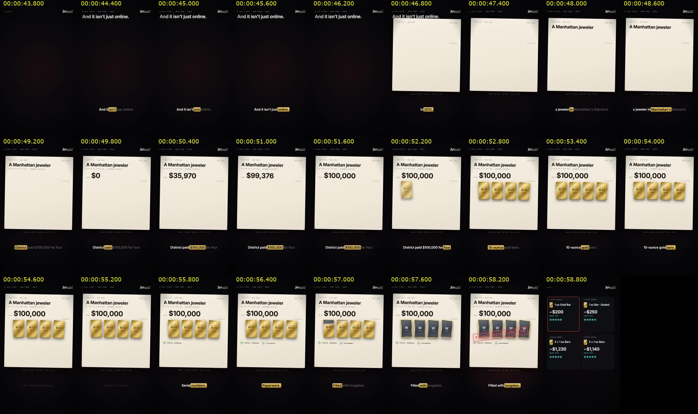
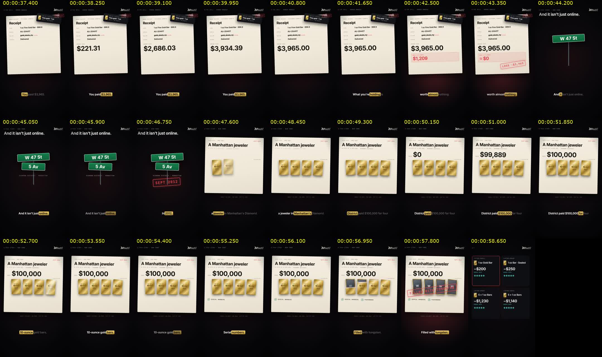
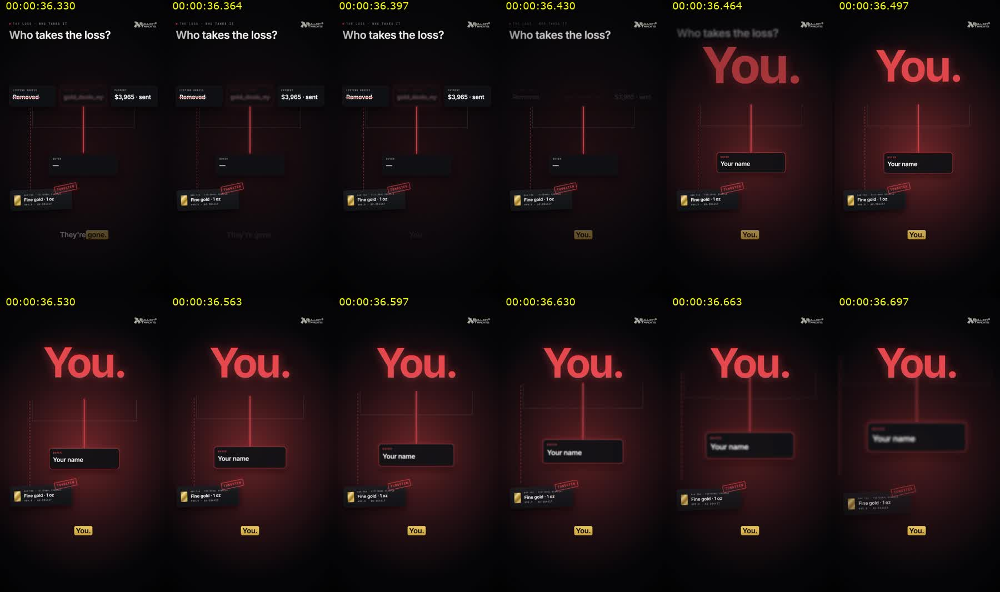

# 04 · Review and improvement

A film is finished when the rendered file has been watched and measured — not when the code compiles. This is
the loop used for every Bullion Trading film, with what it caught on *What's inside?*.

## The review loop

1. **Stills at the words** — render frames at the moments a reveal should land:
   `node scripts/premium-stills.mjs Bullion-WhatsInside 3.6 21.1 30.7 36.75 --scale=0.4`
   Check layout, collisions, text sizes, colour meaning.
2. **Motion grids from the real render** — `scripts/review-grid.sh out/…/film.mp4 31 37.5 0.25 9 3 240 who.jpg`.
   Look for dead air, late or early reveals, things that pop instead of move, transitions that blank the frame.
3. **Frame-step the big moments at 60 fps** — e.g. the 12 frames around "You." Grid labels can drift a frame;
   confirm with `ffmpeg -ss <t> -i film.mp4 -frames:v 1 still.jpg` before changing anything.
4. **Measure the sound** — the render report (`out/marketing/<group>/render-report*.json`) must say −14 LUFS,
   true peak ≤ −1 dBTP. For the score, read the score report's events, the spectrogram, the RMS of quiet
   passages, and which moments reach the limiter (only the biggest reveals should).
5. **Fix at the source** (scene code, script, schedule, score), re-render, and look again at the same moments.

## Publish checklist

- [ ] Something moves in the first frame; the hook is spoken or shown in the first 2 s.
- [ ] No passage of more than ~0.5 s where nothing changes or the frame is empty.
- [ ] Every reveal lands on its word; nothing collides with captions, the headline or the carried object.
- [ ] Text is readable on a phone (sizes in 03-graphics); units lowercase; numbers match the narration.
- [ ] Every fact is current and sourced; date-sensitive numbers re-checked today (spot price!).
- [ ] Nothing from the "claims we do not make" list (01-strategy §3); fictional items are labelled.
- [ ] Closing line and CTA are correct; website and address are right.
- [ ] Captions file generated; loudness −14 LUFS / ≤ −1 dBTP; 1080×1920, 60 fps, H.264 + AAC.

## Lessons from *What's inside?*

| Problem found in review | Fix that worked |
| --- | --- |
| First 1.5 s showed an empty price card | price card opens as a live hero, ticking from frame 1, then rises to make room |
| 2.4 s of a lone headline on black, then a blank cream page | open the case on the location itself (NYC street signs W 47 St / 5 Av, SEPT 2012 stamp); the case file arrives already written and holding the bars |
| The carried tag blurred and popped at every cut | moved to one global layer above the scene shells; it now slides, stays, takes stamps and clips onto the receipt |
| Bar sat in front of the parcel instead of coming out of it | draw the box front over the bar while it lifts |
| "Light text on cream paper" made checks invisible | `ink` option on `Check` for paper |
| "G" instead of "g" from uppercase mono styling | `textTransform: 'none'` on units |
| "You." collided with the node chain for 10 frames | clear the chain 3 frames before the word; later rebuilt the scene around a loss chip that drops into your card |
| The quiet question was louder than the tension bed | cut the sub and heartbeat; measure RMS per passage |
| The opening stamp hit the limiter like the big reveals | rebalance gains so only the reveals reach it |
| A scene's opening waited for its first word | bring the cast in from the scene's first frames; keep word cues for the reveals |

Before / after — the 2012 case passage:

Frame-by-frame check of the "You." hit:

## Improvement backlog

- **Cut-downs**: 30 s and 15 s versions of each story/FAQ film for ads (keep the hook and the CTA; drop middle beats).
- **A/B hooks**: two openings per film (number-led vs. question-led) for paid tests; concepts 1 and 2 of the
  campaign study are the first candidates.
- **Real product photography** in story films where it doesn't conflict with the claim rules (never in
  counterfeit contexts).
- **Shared story kit**: promote `BarTag`, `Stamp`, `Paper`, `LossChip`-style pieces into a reusable package if a
  second story film is made.
- **Date-sensitive data from one place**: read spot price and listing figures from a single data file so a
  refresh doesn't need code edits.
- **Owner sign-off** on in-office testing and pre-shipping inspection wording before those films run as ads.
